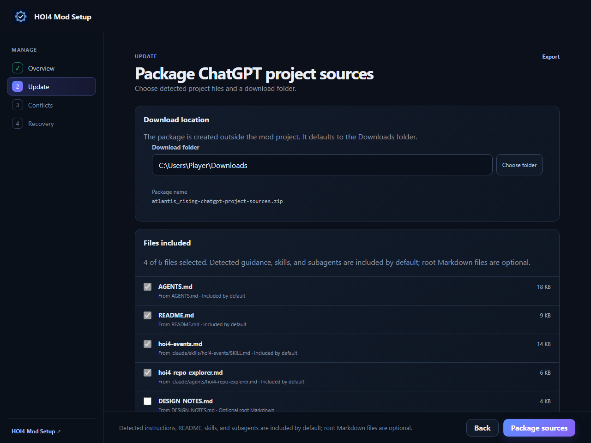

# HOI4 Mod Setup

HOI4 Mod Setup is a desktop wizard for preparing a Hearts of Iron IV mod for
AI-assisted development. Start a new mod from its name and description, or
choose an existing mod to add, update, or repair its development setup.

The installed workflow is Claude-first: `CLAUDE.md`, the skills in
`.claude/skills/`, and the specialist subagents in `.claude/agents/` are the
canonical files, each subagent has a fixed Claude model tier, and the HOI4 Agent
Tools MCP server is installed and registered for you. Codex, Cursor, Qoder, and
OpenCode receive generated copies of the same rules, so you can use them too.

The setup assistant can use Claude, Codex, Kimi, GLM, DeepSeek, a local model,
or a custom provider. Claude is selected by default and signs in through your
own Claude Code. This choice is only for
analyzing and preparing the mod; it does not choose the AI client you use later
for Agentic HOI4 Modding.

## Quick start

Follow the [Windows first-run guide](docs/QUICKSTART.md) to install the app and prepare your mod.

## Download

- Windows: [Download the `.exe` installer](https://github.com/klimPaskov/HOI4-Mod-Setup/releases/latest/download/HOI4-Mod-Setup-windows-x64-setup.exe)
- Mac with Apple silicon: [Download the `.dmg`](https://github.com/klimPaskov/HOI4-Mod-Setup/releases/latest/download/HOI4-Mod-Setup-macos-arm64.dmg)
- Mac with Intel: [Download the `.dmg`](https://github.com/klimPaskov/HOI4-Mod-Setup/releases/latest/download/HOI4-Mod-Setup-macos-x64.dmg)

[View the latest release](https://github.com/klimPaskov/HOI4-Mod-Setup/releases/latest)

On Windows, run the downloaded setup file. On Mac, open the disk image and
move HOI4 Mod Setup to Applications. Your computer may occasionally flag a new
community build as harmful falsely. The project is safe and open source.

## Using the app

The wizard has seven short phases. Nothing is added to the mod until you have
reviewed the changes and started installation.

### 1. Choose a project and setup assistant

Choose **Create new mod** or **Import existing mod**. For Claude, choose
**Sign in to Claude**: your installed Claude Code opens the browser and signs
you in with your Claude account, and the app never sees your Claude
credentials. If Claude Code is not installed yet, the app links to Anthropic's
setup page. For Codex, sign in with ChatGPT. For Kimi, GLM, DeepSeek, or
**Claude API key**, paste an API key from the provider;
the app fills the normal connection details automatically. Local and custom
models let you enter the address supplied by that model service. Once connected,
choose from the provider's live model list and select one of the reasoning
levels that model supports, from **Light** through **Max**. Claude defaults to
Claude Haiku 4.5; Codex defaults to GPT-5.6 Luna with Extra high reasoning;
DeepSeek defaults to its Flash model.

**Manage an existing project** scans any selected mod before changing it. If the
scan finds app-managed setup, the view also offers repair, update, optional
workflow, and removal actions. Choose the project folder; the app finds its
launcher file.

When the scan finds an `AGENTS.md`, flattened skill, or subagent, the scan
results and maintenance view offer **Package ChatGPT project
sources**. The package page defaults to the Downloads folder, keeps `AGENTS.md`,
`README.md`, every flattened skill, and every subagent selected, and lists root
Markdown files as optional unchecked entries. The ZIP is written outside the
mod project without changing it.

### 2. Describe the mod and review its details

For a new mod, enter its name and a short description.

The app fills the project ID, script prefix, namespace, valid descriptor tags,
starter folders, standard HOI4 mod location, and launcher file. Every generated
value remains editable. It also prepares `descriptor.mod`, the launcher
descriptor, and a replaceable 600x600 black `thumbnail.png`.

For an existing mod, a read-only scan checks the descriptors, project
instructions, skills, subagents, Codex/MCP configuration, managed setup state,
bounded Git evidence, and possible setup conflicts before any changes are
offered. It does not open or count ordinary gameplay, localisation, media, or
unrelated data dumps, so even very large mods stay within the setup scan.

### 3. Choose what to install

Select the instructions, skills, helpers, tools, and offline wiki you want.
Required items stay selected so the project remains usable.

Before the component list, choose **Coding environments**. Select exactly one
primary client (Claude Code is the default), then add any combination of the
other clients the source package declares, such as Codex, Cursor, Qoder, and
OpenCode. The primary is removed from the additional choices automatically.
The canonical `CLAUDE.md`, `.claude/skills/`, `.claude/agents/`, runtime
synchronizers, documentation, and selected workflows are always installed;
each additional client receives its generated package, for example
`AGENTS.md`, the `.agents/skills/` copy, and `.codex/agents/*.toml` for Codex.
This client choice is independent of the setup assistant and of the workflow
profiles. For an existing project, the app detects installed clients and
removes only unchanged managed files when one is deselected; modified files are
preserved.

The component list, the coding environments, and the optional workflows all
come from the exact published Agentic HOI4 Modding manifest. When that
repository publishes changed skills, new skills, new subagents, new clients, or
compatible new components, **Latest** mode can use them without a new HOI4 Mod
Setup release. The app also fills in the Hearts of Iron IV and Workshop folders
it finds through your Steam libraries, so the instructions point at your real
game files. Update adds newly published default-profile
components while preserving earlier optional choices and local-file conflict
review.

Independently of the setup assistant, **Prepare a flattened ChatGPT project-sources folder**
creates a separate folder with the adapted project guidance, README, selected
skills, and selected subagents. The offline wiki is not copied into this
folder. Its file list and sizes are shown before installation.

### 4. Add optional workflows

The 3D workflow is optional and currently follows the source repository's
Windows route. If selected, a Meshy key is stored in Windows Credential Manager
and is never written into the mod. After reviewed project files are applied,
the app runs the verified source bootstrap to prepare `uv`, the bounded Blender
adapter, Meshy, and the reviewed MCP routes. Missing credentials or tools leave
only this optional workflow incomplete; they do not make core setup unusable.

The HOI4 Agent Tools MCP integration installs the exact package version the
source manifest records, checks the routes that version advertises, and
registers the server for each selected client (the project `.mcp.json` for
Claude Code). Its verified package and app-owned health check work with every
AI provider.

The optional **HOI4 Live Tools** workflow installs the separate HOI4 Live Tools
MCP server, which drives a running game on Windows for live feature tests, and
adds the `hoi4-live-playtest` skill and its setup guide. Setup runs the
package's reviewed bootstrap: it checks for Python 3.9 or newer, downloads the
release the package pins and verifies its size and SHA-256, installs it for
your user under `%LOCALAPPDATA%\hoi4-live-tools` with a private Python
environment, starts it once to confirm it lists its tools, and registers it in
the user configuration of the coding clients it finds (Claude Code, Codex,
Cursor, OpenCode). The result appears on the readiness page as ready or
incomplete with the reason; the project files stay either way. The installed
program and the client entries are external tool state: Remove leaves them, and
`python install.py uninstall` from the HOI4 Live Tools release removes them.

The optional Super Events workflow adds the reusable popup, templates,
examples, images, and supporting guidance needed to add more Super Events.
Installed runtime filenames use the confirmed mod script prefix; `hoi4ms_*`
remains only as the upstream source-package naming.

The optional ComfyUI portrait production workflow supports Comfy Cloud, Local
ComfyUI, RunPod, or Disabled for generic projects. Its expanded panel shows the
minimum requirement: **16 GB VRAM and 25 GB storage**. Only the selected
provider's instructions are installed. Sourced portraits use the pinned source
or processing workflow; non-sourced fictional or impossible portraits use
the configured image generator and never enter ComfyUI. See
[`docs/32_comfyui_portrait_pipeline.md`](docs/32_comfyui_portrait_pipeline.md)
for the current workflow and setup details.

### 5. Choose Git setup

Initialize Git, preserve an existing repository, or skip Git. You can keep the
project local, connect an existing remote, or create a public GitHub repository.
Publishing and pushing always require a separate confirmation.

### 6. Review and install

Review the files and folders that will be added or updated. If an existing file
was edited, the app asks whether to keep it, use the new version, merge it, keep
both, or skip the change when those choices are valid.

Installation shows live progress, completed file counts, percentages, and an
estimated time. If setup is interrupted, reopening the project offers the safe
recovery choices that still apply.

### 7. Open the prepared project

The Ready screen checks the project, instructions, selected tools, offline
wiki, Git state, and optional workflows. When the required checks pass, the
main button opens the project in your primary client: **Open in Claude Code**
starts Claude Code in a new terminal window in the project folder, and **Open
in Codex** opens the Codex app when Codex is primary.

ChatGPT source files are an optional setup check and stay out of the Ready
summary. Installed projects include `.tools/package_chatgpt_project_sources.py`
and its Windows `.bat` launcher. Run `python .tools/package_chatgpt_project_sources.py`
to build a curated folder and `all-project-sources.zip` in Downloads; use
`--dry-run`, `--include`, `--exclude`, or `--config` to review and adjust the
selection. Choose a new `--output` folder for each export. The tool never uploads
files. See the [source-packaging contract](docs/33_chatgpt_source_packaging.md).
When the optional portrait workflow is enabled, it also shows its persisted Cloud, Local, or RunPod readiness and
canonical source guidance, or the explicit Disabled state. RunPod runs
API-first; computer control is used only when explicitly requested.
Non-sourced fictional or impossible portraits use the configured image generator. Disabled
generic projects keep source-based portrait handling without ComfyUI-specific
project files. See
[`docs/32_comfyui_portrait_pipeline.md`](docs/32_comfyui_portrait_pipeline.md).

### Update, repair, or add a workflow later

Open **Manage an existing project** to check for setup updates, repair missing
or damaged files, change the portrait provider, add the 3D or Super Events
workflow later, remove installed components, or recover an interrupted setup.
Changes are shown for review before they are applied.

**Remove components** deletes only the setup files the app installed and has
not seen you change, then removes the folders that this leaves empty. Setup
files you edited are shown for review first, and your own mod content is never
touched.

The source-package page shows the external download folder and the exact files
that will be included. Required flattened sources stay selected; root Markdown
files are optional and unchecked until chosen.

HOI4 Mod Setup checks for app updates when it opens. If a newer signed version
is found, the app shows the update immediately, downloads and verifies it,
replaces the current installation, and restarts into the new version. If the
update fails, the running version remains usable and a retry action appears.

## Troubleshooting

See [Troubleshooting](docs/TROUBLESHOOTING.md) for sign-in, setup source, MCP, and interrupted installation fixes.

## Privacy

HOI4 Mod Setup has no telemetry. Provider keys stay in Windows Credential
Manager or macOS Keychain. ChatGPT sign-in is handled by Codex, and secret
values are not written into the mod.

## License

HOI4 Mod Setup is released under the [Apache License 2.0](LICENSE).
