# HOI4 Mod Setup

[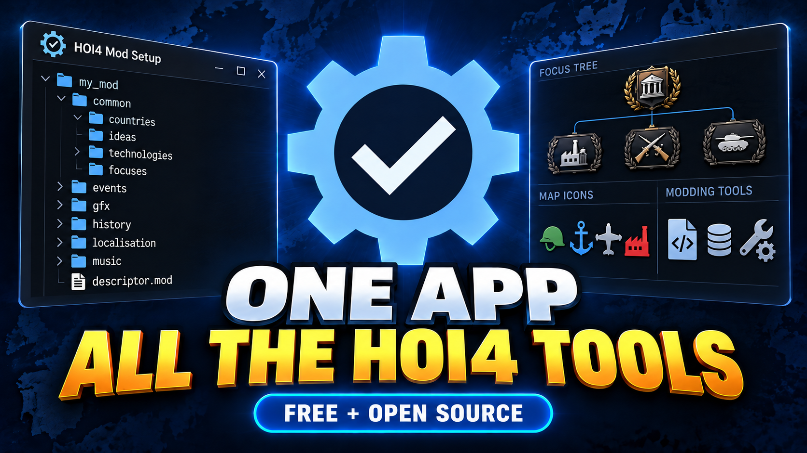](https://www.youtube.com/watch?v=qdFbLO92dQI)

Prepare a new or existing Hearts of Iron IV mod for AI-assisted development.
HOI4 Mod Setup creates the mod files, installs project instructions, skills,
specialist subagents, tools, and an offline wiki, and opens your coding client.
You can update the setup, repair it, or add workflows later.

Choose any supported coding client. Codex, Claude Code, Cursor, Qoder, and
OpenCode can use the same modding guidance through their own client packages.
Setup packages in manifest format 6 add GitHub Copilot (VS Code), Gemini CLI,
Antigravity, Grok Build, Kilo Code, Kiro, Qwen Code, Cline, Devin Desktop,
Augment, Continue, and Aider.
The workflow comes from [Agentic HOI4 Modding](https://github.com/klimPaskov/Agentic-HOI4-Modding).
It also installs [HOI4 Agent Tools](https://github.com/klimPaskov/hoi4-agent-tools), which lets your agent build focus trees, events, decisions and maps, and offers optional live testing with [Clausewitz MCP by smerss](https://github.com/smerss/Clausewitz-MCP) or experimental [HOI4 Live Tools](https://github.com/klimPaskov/HOI4-Live-Tools).

## Download

- Windows: [Download the `.exe` installer](https://github.com/klimPaskov/HOI4-Mod-Setup/releases/latest/download/HOI4-Mod-Setup-windows-x64-setup.exe)
- Mac with Apple silicon: [Download the `.dmg`](https://github.com/klimPaskov/HOI4-Mod-Setup/releases/latest/download/HOI4-Mod-Setup-macos-arm64.dmg)
- Linux x86-64: [Download the AppImage](https://github.com/klimPaskov/HOI4-Mod-Setup/releases/latest/download/HOI4-Mod-Setup-linux-x64.AppImage) or [Debian package](https://github.com/klimPaskov/HOI4-Mod-Setup/releases/latest/download/HOI4-Mod-Setup-linux-x64.deb)
- Mac with Intel: [Download the `.dmg`](https://github.com/klimPaskov/HOI4-Mod-Setup/releases/latest/download/HOI4-Mod-Setup-macos-x64.dmg)

On Linux, follow the [Linux install guide](docs/LINUX.md).

On Windows, run the downloaded setup file. On Mac, open the disk image and
move HOI4 Mod Setup to Applications. Community Windows builds are signed by
ChaosX; community Mac builds use ad-hoc signing. See the
[release notes](https://github.com/klimPaskov/HOI4-Mod-Setup/releases/latest)
for your download's signing details.

Follow the [first-run guide](docs/QUICKSTART.md) for Windows, macOS and Linux,
or visit the [project guide](https://klimpaskov.github.io/HOI4-Mod-Setup/).
Watch [One App, All HOI4 Tools on YouTube](https://www.youtube.com/watch?v=qdFbLO92dQI) for a video walkthrough.

## Using the app

### Choose a project and setup assistant

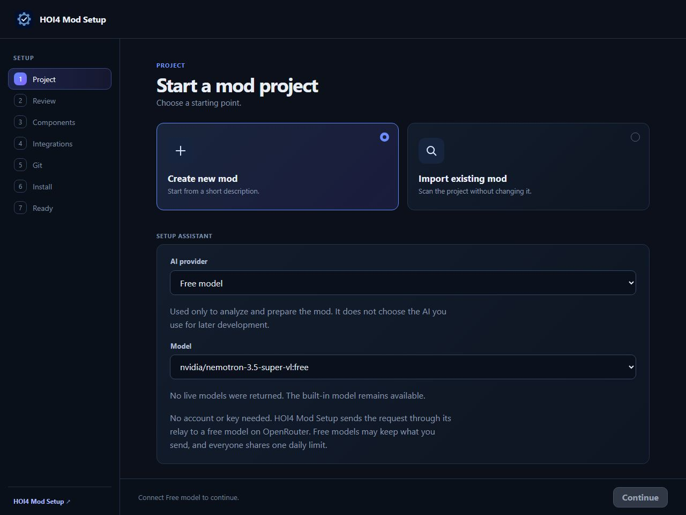

Choose **Create new mod** or **Import existing mod**. The setup assistant helps
prepare the mod's details; choose your coding environment separately later.

The setup assistant that plans the mod is separate from the coding client you
choose later. Select any supported assistant provider and use its account
sign-in, API key, or local connection. Gemini and Grok API-key profiles use the
app's reviewed provider routes; experimental provider-account routes, when
shown, keep sign-in inside the provider's own CLI. Choose a model and
reasoning level when the provider offers them. Claude defaults to Haiku 5.5 at
medium effort, keeps legacy Haiku 4.5, and lets advanced users enter an exact
Claude model ID.

The experimental Gemini and Grok account options open the official provider
client in a separate sign-in window and never ask you to paste a token. They
are currently verified only on Windows and Linux; use the corresponding
API-key profile when the account route is unavailable on your computer.

To work on a mod you already have, choose **Manage an existing project** and
select its folder. The app finds its launcher file and installed setup.

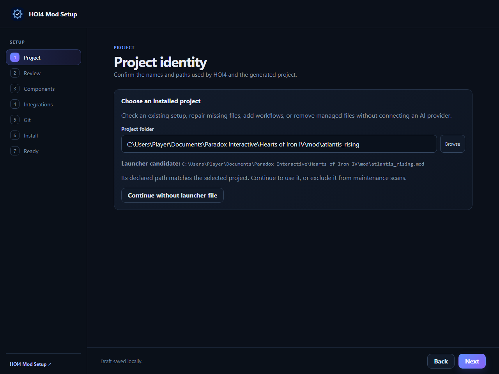

### Describe the mod and review its details

For a new mod, enter its name and a short description.

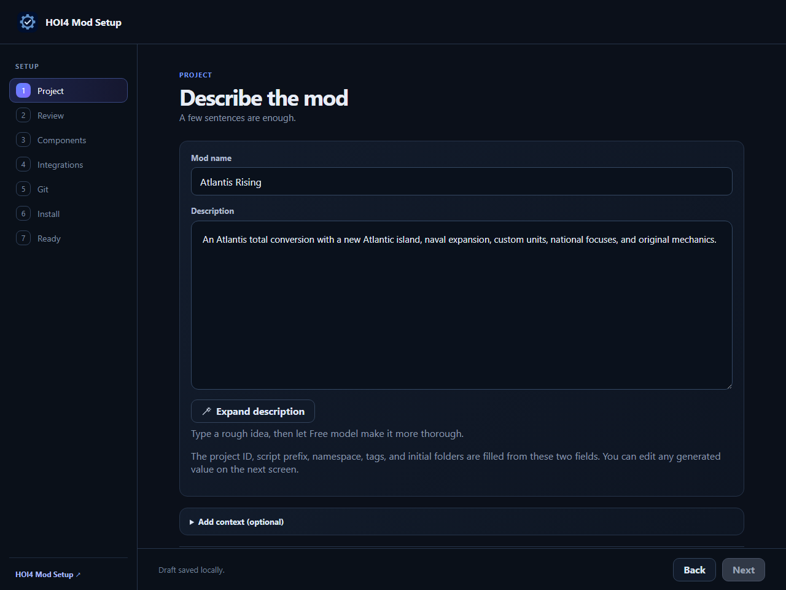

The app suggests a project ID, script prefix, namespace, tags, and starter
folders. It fills the standard HOI4 mod location and launcher file. Edit any
value before continuing. Setup creates both `descriptor.mod` files and a replaceable
600x600 black `thumbnail.png`.

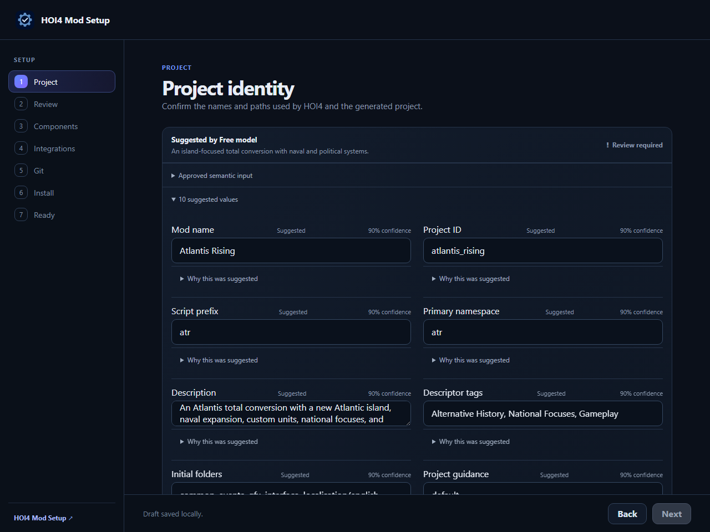

For an existing mod, the app checks its descriptors, instructions, skills,
subagents, client configuration, and Git state, then shows what needs attention.

### Choose your coding clients and components

Select any supported coding client as your main one, then add other clients you use.
Codex, Claude Code, Cursor, Qoder, and OpenCode are supported, and setup
packages in manifest format 6 add twelve more clients. Cline, Devin Desktop,
Augment, and Continue keep MCP servers in their own settings, so the Ready
screen links their setup guide; Aider has no MCP support.

### Choose how to make images

Pick a main image provider and add optional providers. ChatGPT through GPTImage
is selected by default. The list also includes image APIs, local servers, Codex
image generation when Codex is the main client, and a choice to make art yourself.
The app stores API keys in the operating-system credential store.

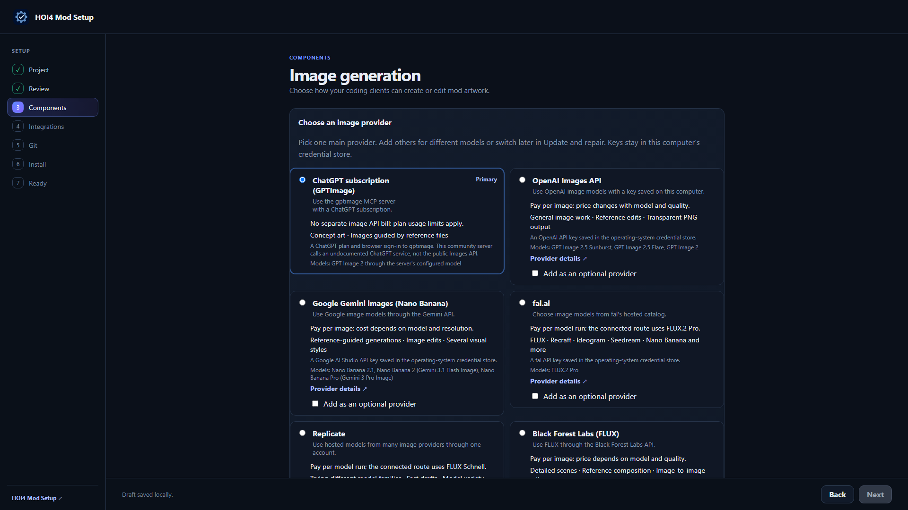

Choose instructions, skills, tools, and the offline wiki. The app adapts the
guidance to your mod and fills the game and Workshop folders it finds through
Steam. Required components stay selected.

Choosing an image provider automatically selects its required setup component;
changing providers removes stale image-route components before the next review.
The final dependency and file plan is always checked by the app core.

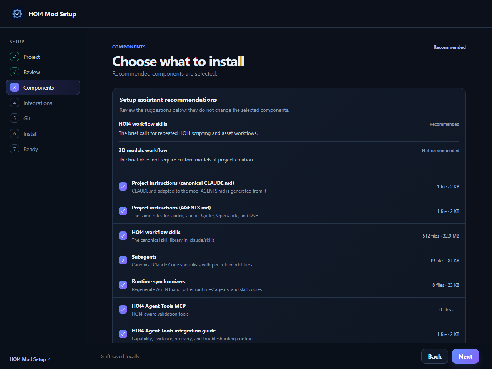

**Latest** is the default and uses the current published Agentic HOI4 Modding package. You can also
choose a specific commit or release. Updates bring in published components and
keep your optional workflow choices.

**ChatGPT project-sources packager** is an optional component. Check it to add
`.tools/package_chatgpt_project_sources.py`, a script you run yourself to export
project files for a ChatGPT project.

### Add optional workflows

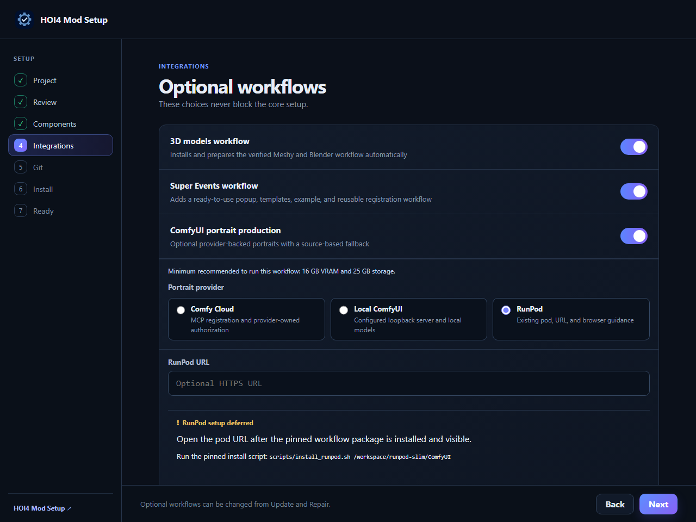

- **3D models workflow** prepares Meshy and Blender on Windows. Add a Meshy key
  to use it; the key stays in Windows Credential Manager. Missing tools or
  credentials leave this workflow incomplete while the rest of setup remains
  usable.
- **Super Events workflow** adds the popup, templates, example, assets, and
  guidance for building Super Events with your mod's script prefix.
- **ComfyUI portrait production** supports Comfy Cloud, Local ComfyUI, or RunPod.
  Its expanded panel shows the 16 GB VRAM and 25 GB storage recommendation.
  See the [portrait workflow guide](docs/32_comfyui_portrait_pipeline.md).
- **Live testing** opens a separate provider step. Clausewitz MCP by smerss is
  the default and requires native Linux HOI4 1.19.2 and a separately prepared
  Linux server: WSL on Windows, or a Linux machine/VM through SSH on macOS.
  Follow the [Linux setup guide](docs/LIVE_TESTING_LINUX.md), then explicitly
  confirm readiness. Configure later records a to-do without registration.
  HOI4 Live Tools is experimental, slower, and not fully tested; its current
  public package verifies Windows only, with an incomplete macOS scaffold.
  None disables live testing. The next capture is `17-live-testing.png`.

HOI4 Agent Tools installs and registers its MCP server for your selected coding
clients on Windows, including `.mcp.json` for Claude Code. It works independently
of the assistant you used for setup.

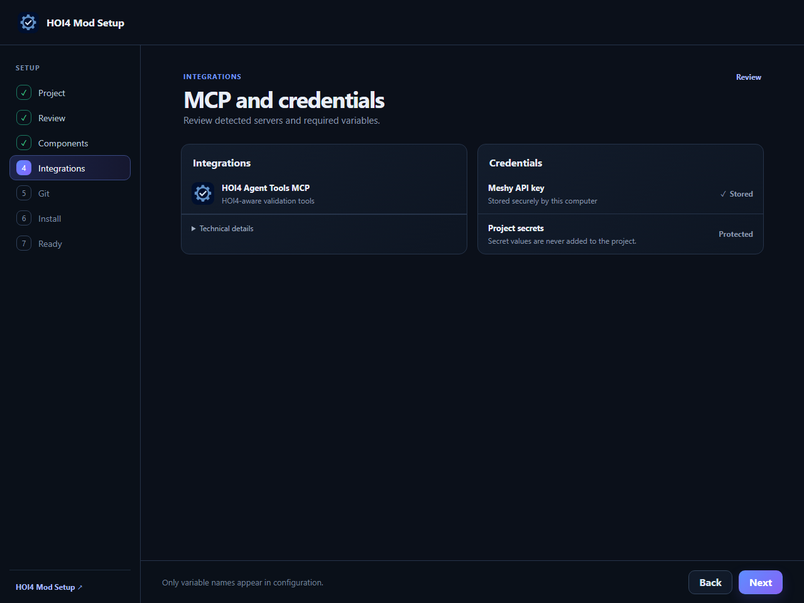

### Choose Git setup

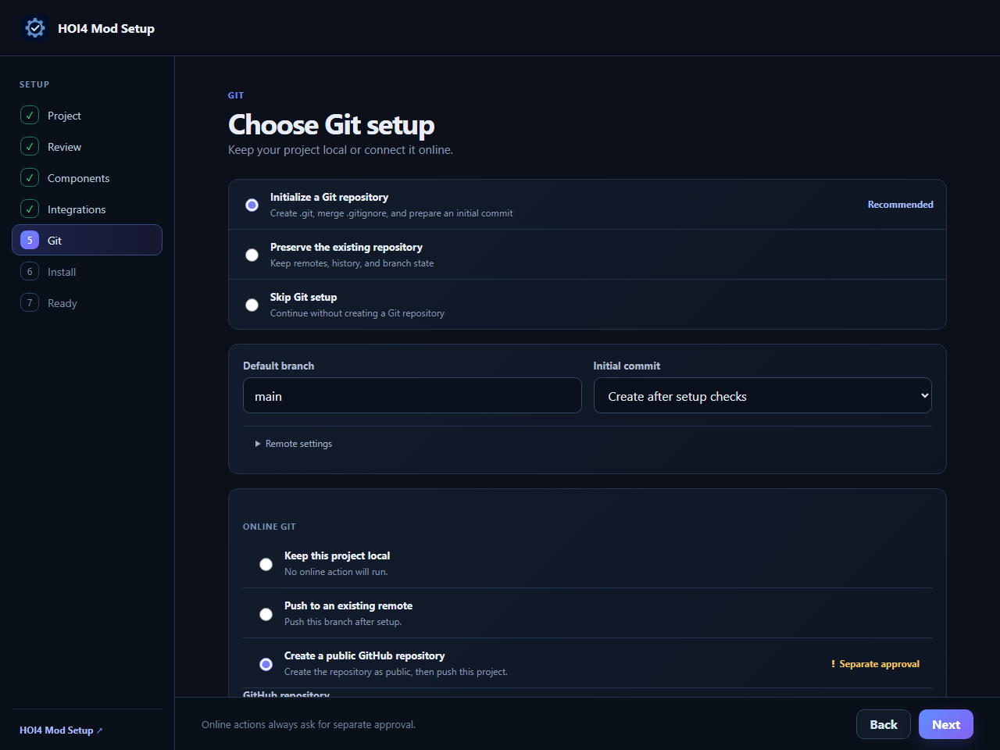

Initialize Git, keep an existing repository, or skip Git. Keep the mod local,
connect a remote, or create a public GitHub repository. Publishing and pushing
ask for a separate confirmation.

### Review and install

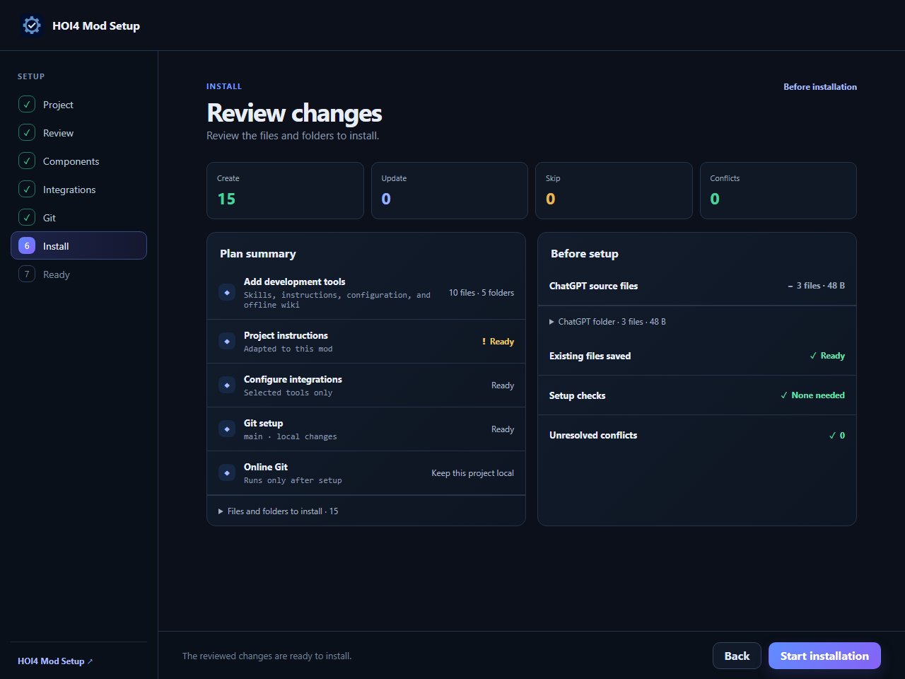

Review the files and folders to add or update, then start installation. For an
edited file, choose to keep your version, use the incoming version, merge, keep
both, or skip when available. Installation shows file counts, progress, and an
estimated time.

Changes are written to your mod folder; use Git to review or undo them.

If setup stops, reopen the project to continue, undo changes, or discard
prepared files. The app offers the actions available for that installation.

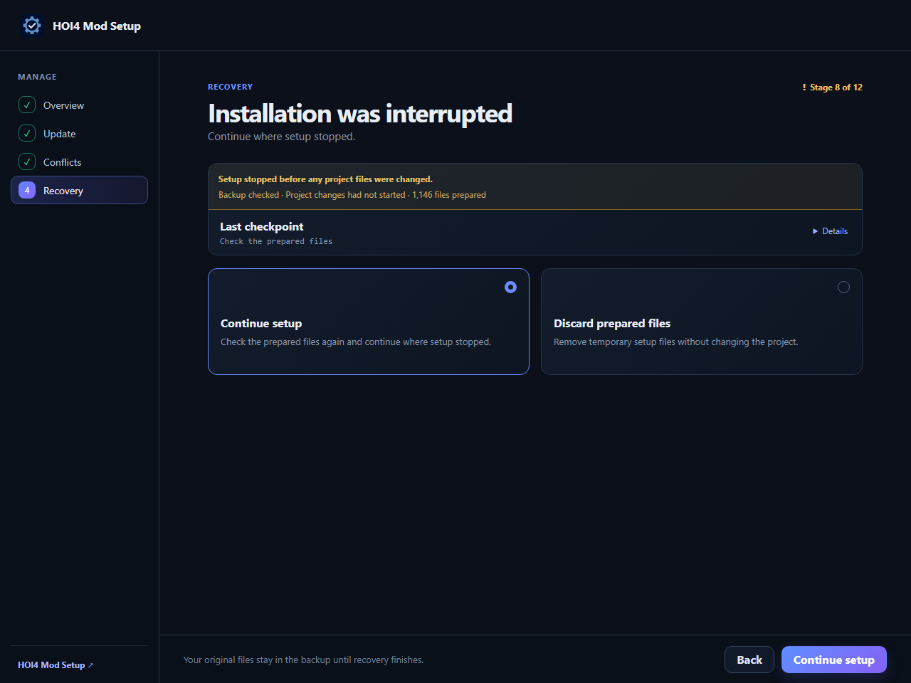

### Open the prepared project

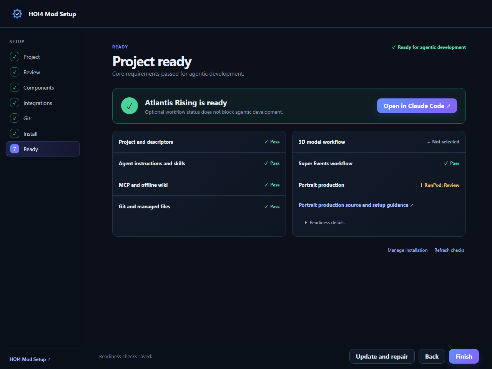

The Ready screen shows the project and tool checks. **Open in your primary
client** starts that client in the mod folder when it is available. Optional
workflows show their own setup status.

For ChatGPT, check the optional packager component during setup. It adds
`.tools/package_chatgpt_project_sources.py` and a Windows `.bat` launcher; the
app never runs them or uploads anything.
Run `python .tools/package_chatgpt_project_sources.py` to export a folder and
`all-project-sources.zip` to Downloads. Use `--dry-run`, `--include`, `--exclude`,
or `--config` to adjust the selection, and a new `--output` folder for each
export. See the [source-packaging guide](docs/33_chatgpt_source_packaging.md).

### Update, repair, or add workflows later

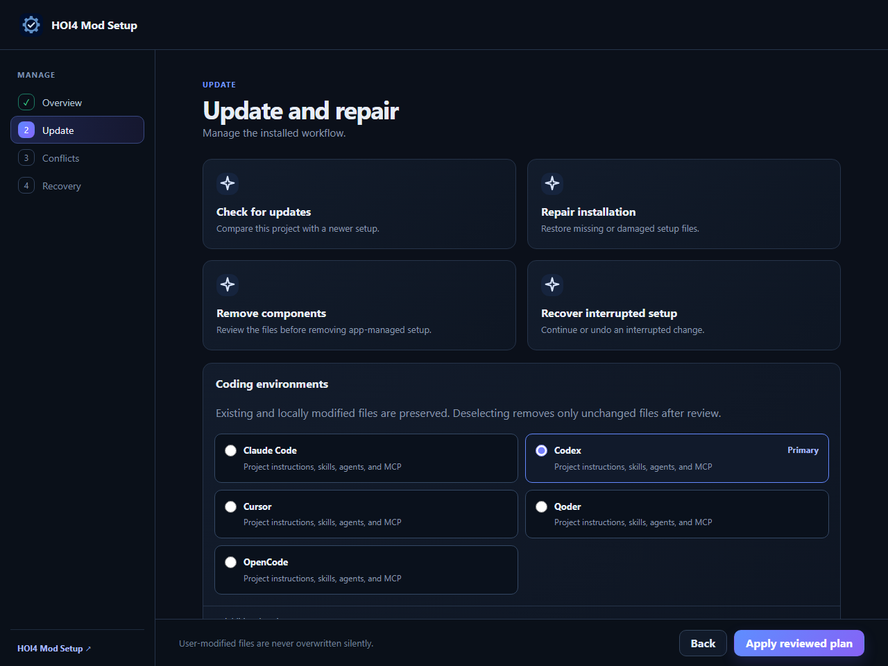

Open **Manage an existing project** to update or repair setup files, change
coding clients or the portrait provider, add workflows, remove components, or
recover an interrupted installation.

**Update source** defaults to **Latest verified source**, including for projects
installed from an older pin. Choose a commit or release to pin instead, then
review and confirm the update. MCP versions follow the selected package's
verified manifest. **Repair installation** keeps the installed revision.

**Remove components** removes unchanged files installed by the app and the
folders left empty. Edited setup files are shown for review; your mod content
stays in place.

The app checks for updates when it opens and installs a newer signed version
automatically. If an update fails, you can keep using the app and retry.

## Troubleshooting

See [Troubleshooting](docs/TROUBLESHOOTING.md) for sign-in, setup source, MCP,
and interrupted installation fixes.

## Privacy

HOI4 Mod Setup has no telemetry. Provider keys stay in Windows Credential
Manager, macOS Keychain or Linux Secret Service. Claude Code and Codex handle their own account
sign-in. Secret values are not written into the mod.

## License

HOI4 Mod Setup is released under the [Apache License 2.0](LICENSE).
