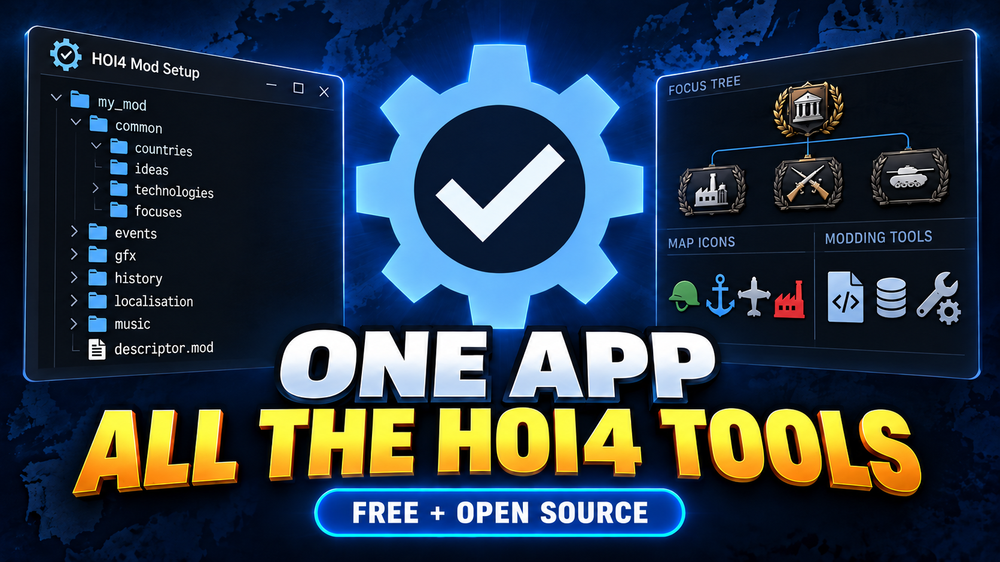

  

<h1 align="center">HOI4 Mod Setup</h1>

  Prepare a new or existing <em>Hearts of Iron IV</em> mod for AI-assisted development.

  
  
  
  
  

  <a href="#desktop-app-recommended">Desktop app</a> ·
  <a href="#web-edition-lightweight">Web edition</a> ·
  <a href="docs/QUICKSTART.md">Quick start</a> ·
  <a href="docs/USER_GUIDE.md">User guide</a> ·
  <a href="docs/TROUBLESHOOTING.md">Troubleshooting</a>

  

Project instructions, skills, subagents, HOI4 tools, and an offline wiki for Claude Code, Codex,
Cursor, and [many more coding clients](docs/36_coding_environment_catalog.md).

**Two ways to use it:**

- **[Desktop app](#desktop-app-recommended)** (recommended): the full setup for Windows, macOS, and Linux.
- **[Web edition](#web-edition-lightweight)**: lighter and faster for the basics, with nothing to install.

## Desktop app (recommended)

Writes into your mod after you review every change, with a backup and **Undo changes**. Installs
the HOI4 Agent Tools, supports Claude and ChatGPT sign-in, Git, and the 3D workflow, and can update,
repair, or remove its setup later.

- Windows: [`.exe` installer](https://github.com/klimPaskov/HOI4-Mod-Setup/releases/latest/download/HOI4-Mod-Setup-windows-x64-setup.exe)
- Mac: [Apple silicon `.dmg`](https://github.com/klimPaskov/HOI4-Mod-Setup/releases/latest/download/HOI4-Mod-Setup-macos-arm64.dmg) · [Intel `.dmg`](https://github.com/klimPaskov/HOI4-Mod-Setup/releases/latest/download/HOI4-Mod-Setup-macos-x64.dmg)
- Linux: [AppImage](https://github.com/klimPaskov/HOI4-Mod-Setup/releases/latest/download/HOI4-Mod-Setup-linux-x64.AppImage) or [Debian package](https://github.com/klimPaskov/HOI4-Mod-Setup/releases/latest/download/HOI4-Mod-Setup-linux-x64.deb) ([Linux guide](docs/LINUX.md))

Open it, choose **Create new mod** or **Import existing mod**, and follow the steps. The app
updates itself; [release notes](https://github.com/klimPaskov/HOI4-Mod-Setup/releases/latest) list the
signing details.

## Web edition (lightweight)

[**Open the web edition →**](https://klimpaskov.github.io/HOI4-Mod-Setup/app/) Nothing to install and
nothing uploaded. Start a new mod or drop your mod's folder, review the result, and download a ZIP to
unpack over a **copy** of your mod. When you want more later, download the extra pieces manually or use
the desktop app for the fuller install.

## Existing mods

Your `descriptor.mod`, `thumbnail.png`, `README.md`, and mod content are never overwritten. Importing
only reads the folder. Updating again shows only the files you edited, and an interrupted install can
be undone. Details in the [user guide](docs/USER_GUIDE.md#existing-mods-import-reimport-update).

## Learn more

- [Quick start with screenshots](docs/QUICKSTART.md) and the [full user guide](docs/USER_GUIDE.md)
- [Troubleshooting](docs/TROUBLESHOOTING.md): sign-in, setup source, MCP, interrupted installs
- [Contributing](CONTRIBUTING.md), [development setup](DEVELOPMENT.md), [releasing](RELEASING.md), [security](SECURITY.md)
- The workflow comes from [Agentic HOI4 Modding](https://github.com/klimPaskov/Agentic-HOI4-Modding)
  and [HOI4 Agent Tools](https://github.com/klimPaskov/hoi4-agent-tools)

## Privacy

No telemetry. Provider keys stay in Windows Credential Manager, macOS Keychain, or
Linux Secret Service (desktop) or in the open tab's memory (web); secret values
are never written into your mod. The web edition lists every network request it
makes under **Network**.

## License

Apache License 2.0. See [LICENSE](LICENSE).
