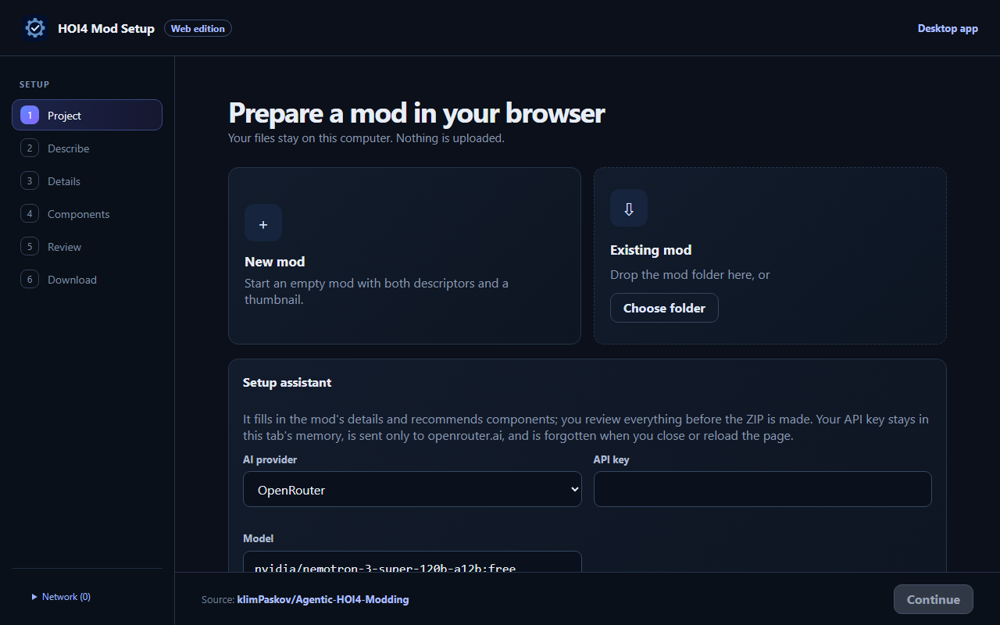

# HOI4 Mod Setup

Prepare a new or existing **Hearts of Iron IV mod** for AI-assisted development.
It adds project instructions, skills, specialist subagents, HOI4 tools, and an
offline wiki, adapted to your mod, for Claude Code, Codex, Cursor, and
[many more coding clients](docs/36_coding_environment_catalog.md). It is for HOI4
modders who want an AI agent that knows how their mod and the game's script work.

### [**Try the web version →**](https://klimpaskov.github.io/HOI4-Mod-Setup/app/)

No install, nothing uploaded. Or [download the desktop app](#download).

## Quick start

**In your browser** (about five minutes):

1. Open the [web edition](https://klimpaskov.github.io/HOI4-Mod-Setup/app/).
2. Choose **New mod**, or drop your mod's folder on **Existing mod**.
3. Pick a setup assistant: the free model when offered, **Sign in with
   OpenRouter**, or your own API key (Claude, Gemini, Grok, DeepSeek, GLM).
4. Review what it found and suggests, then **Download** the ZIP.
5. Unpack the ZIP over a **copy** of your mod (or a Git checkout) and open the
   folder in your coding client.

**On your computer:** [download](#download), open the app, choose **Create new
mod** or **Import existing mod**, and follow the steps. The app backs up
first, shows every change before it writes, and can undo it.

## Web or desktop?

| | Web | Desktop |
| --- | --- | --- |
| Install | None | Windows, macOS, Linux |
| Writes to your mod | No: you download a ZIP | Yes, after review, with backup and **Undo changes** |
| Existing mods | Drop the folder (read-only) | Pick the folder |
| Update or repair later | Drop the folder again | **Manage an existing project** |
| Your API key | Kept in the tab's memory only | Kept in the OS credential store |
| Claude / ChatGPT account sign-in | No | Yes |
| HOI4 Agent Tools install and checks, Git, 3D workflow, live testing | No | Yes |

## Using an existing mod

- **Your files stay yours.** A valid `descriptor.mod`, `thumbnail.png`, and
  `README.md` are kept as they are, and your mod content is never touched.
- **Import** only reads the folder. Installation then adds the setup on top.
- **Reimport or update** the same folder any time: the app recognises its setup
  and offers **Update** or **Repair**. Unchanged setup files are refreshed; files
  you edited are never overwritten silently and are shown for review (keep,
  use new, merge, keep both, or skip). Repeating an update with nothing new
  changes nothing.
- **Interrupted?** If the app is closed or the computer sleeps during install, the next
  time you open the folder it offers **Undo changes**, which restores the mod
  as it was. A full install takes several minutes, so keep the app open.

More in the [user guide](docs/USER_GUIDE.md#existing-mods-import-reimport-update).

## Download

- Windows: [`.exe` installer](https://github.com/klimPaskov/HOI4-Mod-Setup/releases/latest/download/HOI4-Mod-Setup-windows-x64-setup.exe)
- Mac, Apple silicon: [`.dmg`](https://github.com/klimPaskov/HOI4-Mod-Setup/releases/latest/download/HOI4-Mod-Setup-macos-arm64.dmg) · Intel: [`.dmg`](https://github.com/klimPaskov/HOI4-Mod-Setup/releases/latest/download/HOI4-Mod-Setup-macos-x64.dmg)
- Linux x86-64: [AppImage](https://github.com/klimPaskov/HOI4-Mod-Setup/releases/latest/download/HOI4-Mod-Setup-linux-x64.AppImage) or [Debian package](https://github.com/klimPaskov/HOI4-Mod-Setup/releases/latest/download/HOI4-Mod-Setup-linux-x64.deb) ([Linux guide](docs/LINUX.md))

The app updates itself. Signing details for each download are in the
[release notes](https://github.com/klimPaskov/HOI4-Mod-Setup/releases/latest).
Watch the [video walkthrough](https://www.youtube.com/watch?v=qdFbLO92dQI).

## Learn more

- [Quick start with screenshots](docs/QUICKSTART.md) and the [full user guide](docs/USER_GUIDE.md)
- [Troubleshooting](docs/TROUBLESHOOTING.md): sign-in, setup source, MCP, interrupted installs
- [Contributing](CONTRIBUTING.md), [development setup](DEVELOPMENT.md), [releasing](RELEASING.md), [security](SECURITY.md)
- The workflow comes from [Agentic HOI4 Modding](https://github.com/klimPaskov/Agentic-HOI4-Modding)
  and [HOI4 Agent Tools](https://github.com/klimPaskov/hoi4-agent-tools)

## Privacy

No telemetry. Provider keys stay in Windows Credential Manager, macOS Keychain, or
Linux Secret Service (desktop) or in the open tab's memory (web); secret values
are never written into your mod. The web edition lists every network request it
makes under **Network**.

## License

Apache License 2.0. See [LICENSE](LICENSE).
